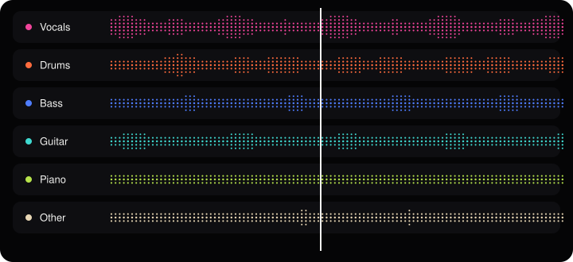
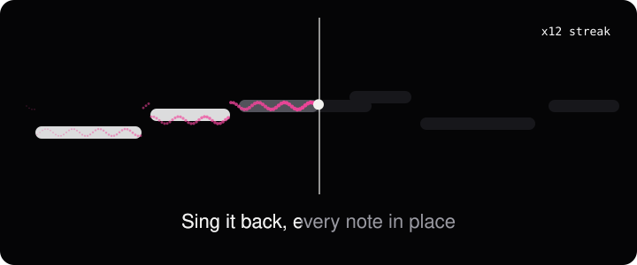
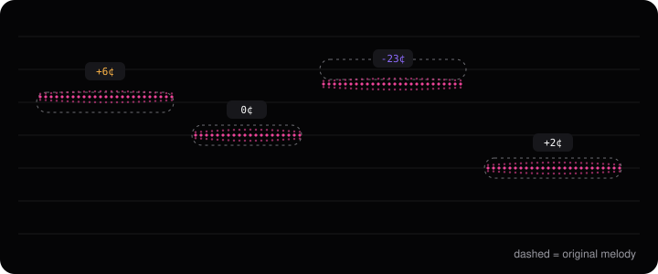
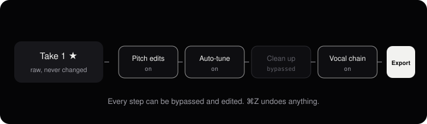
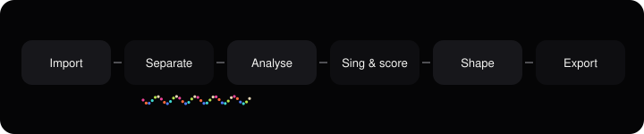

<div align="center">

<picture>
  <source media="(prefers-color-scheme: dark)" srcset="docs/readme/logo-dark.svg"/>
  
</picture>

**Split any song, sing it back, and shape your voice. All on your own machine.**

<a href="https://github.com/xuckless/grain/actions/workflows/ci.yml"></a> <a href="#license"></a>  

[Quick start](#quick-start) · [Guide](docs/guide.md) · [How it works](#how-it-works) · [Develop](#develop) · [License](#license)

</div>

## Every part on its own track

Paste a YouTube link or drop in a file. Grain separates it into vocals, drums, bass, guitar, piano and the rest, and lays them out like a multitrack session. It finds the tempo, the key and the vocal melody as it goes. Mute, solo, mix, or turn any part into MIDI.



## Karaoke that listens

Lyrics arrive already timed. The melody scrolls past as bars and your voice draws a live trail through them. Notes light up as you hit them, and every pass is saved as a take. Afterwards you get a score for pitch, timing, stability and coverage, plus a note-by-note graph of where you were sharp, flat, early or late.



## Fix it like a pro

Auto-tune snaps you to the song's key, live in your headphones or on a take. The pitch editor goes note by note, in the style of Melodyne. Drag a note to move it, flatten drift, shape vibrato, or snap it to the original melody, which sits behind your take as a ghost.



## One take, one chain, nothing destroyed

Star your best take as the master. Pitch edits, auto-tune, noise clean-up and a vocal chain stack on top of it, and the raw recording is never touched. Add harmonies in the song's key, or generate a backing track with local AI. Then export the mix as WAV, MP3 or M4A.



## Quick start

```sh
git clone https://github.com/xuckless/grain && cd grain
pnpm install
python3 scripts/fetch_models.py        # separation + pitch models, sha256-checked
pnpm dev:desktop                       # or: pnpm dev:web → http://localhost:5173
```

Open a song, then try the tabs left to right: **Mix → Score → Karaoke → Auto-tune → Pitch → Produce**. Before your first take, calibrate your mic in **⚙ Settings**. Use headphones when you sing. Optional models, including local AI generation, install from the **Models** panel.

<details>
<summary>Build a desktop app with yt-dlp and ffmpeg bundled</summary>

```sh
python3 scripts/fetch_sidecars.py      # pinned GitHub releases, sha256-checked
pnpm --filter desktop tauri build --bundles app --config src-tauri/tauri.bundle.conf.json
```

Without the bundle config, Grain uses whatever `yt-dlp` and `ffmpeg` it finds on your `PATH`.

</details>

## How it works



<details>
<summary>Each step in detail</summary>

| Step | What happens | Why this way |
| --- | --- | --- |
| **Import** | `yt-dlp` fetches the best audio stream (desktop), or you open a local file. Everything is decoded to 44.1 kHz stereo. | The source is often lossy, so every later step is built to cope with codec artefacts. |
| **Separate** | [HTDemucs](https://github.com/facebookresearch/demucs) splits the mix into six stems through ONNX Runtime. The STFT runs in our Rust code, outside the model. The optional **Best vocals** mode runs a [Mel-Band RoFormer](https://huggingface.co/KimberleyJSN/melbandroformer) first. | Running the STFT ourselves keeps the same graph working natively and on WebGPU. Results are cached per song, so nothing is separated twice. |
| **Analyse** | Tempo comes from onset flux and beat tracking. The key is matched against Krumhansl profiles on the instrumental. The melody comes from [RMVPE](https://huggingface.co/lj1995/VoiceConversionWebUI), segmented into notes. | RMVPE was built for singing inside a full mix, so it tracks vocals where general pitch trackers fail. |
| **Sing & score** | Live pitch uses YIN in Rust. Takes are aligned by known latency plus DTW, then scored per frame and per note in cents. Lyrics come from [LRCLIB](https://lrclib.net). | The scoring is deterministic and documented, with no opaque "vibe score". Latency calibration keeps timing honest. |
| **Shape** | TD-PSOLA for live auto-tune and a phase vocoder for offline work, both preserving formants and both our own Rust. [DeepFilterNet](https://github.com/Rikorose/DeepFilterNet) handles clean-up, and our own DSP vocal chain does the rest. [ACE-Step](https://github.com/ace-step/ACE-Step-1.5) generates backing tracks. | Both shifters are pure Rust, so desktop and web run identical code. AI generation is an opt-in local sidecar, never a cloud call. |
| **Export** | A mixdown of the tracks you choose, plus your processed master take, as WAV-24, MP3 or M4A, or the whole session as a `.grain` archive. | The guide vocal you sang along to never ends up in your export. |

</details>

Grain is a Rust engine (`crates/`) with a Svelte 5 UI (`packages/ui`). The same engine runs natively inside a [Tauri](https://tauri.app) desktop app and compiles to WebAssembly for the web app. Audio-thread code never allocates, locks or runs ML.

## Develop

```sh
cargo test --workspace
cargo clippy --workspace --all-targets -- -D warnings
pnpm check && pnpm build:web
```

The full check list, the perf harness and per-feature walkthroughs are in [docs/guide.md](docs/guide.md). The engineering rules (explicit state machines, no duplication, the real-time and motion rules) are in [AGENTS.md](AGENTS.md). `prototype/` keeps the original Python pitch-comparison script that started it all.

## License

[GPL-3.0](LICENSE).

Models are downloaded at runtime under their own licences, which the Models panel shows. Non-commercial models are opt-in only. [Geist](https://vercel.com/font) fonts are under the SIL OFL. Bundled `ffmpeg` builds carry their own licence in the app's `Resources/licenses`.

Separate, analyse and sing only music you have the right to use. Downloading from YouTube may break its Terms of Service, so Grain only does it on your own machine, for personal use.
